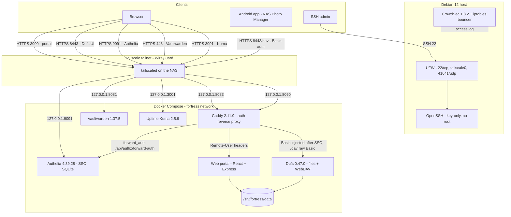

# 05 — Architecture

A deep dive into the running stack on the NAS node (`YOUR_NAS_HOST`,
Tailscale IP `YOUR_TAILSCALE_IP`).

## 1. Overview



## 2. Request flows

**Portal (browser).** HTTPS 3000 → Tailscale Serve → Caddy `:8090` →
`forward_auth` with Authelia → on success Caddy copies `Remote-User`,
`Remote-Groups` onto the request → Express. The backend trusts those headers
only because the only network path to it is Caddy; the port is loopback-only.

**Dufs web UI (browser).** HTTPS 8443 → Serve → Caddy `:8083` → Authelia →
Caddy injects Dufs Basic credentials (`DUFS_ADMIN_BASIC`) → Dufs serves the
file browser. Users therefore sign in once with Authelia and never see the
Dufs password.

**WebDAV (mobile app).** HTTPS 8443/dav → Serve → Caddy `handle_path /dav/*`
→ Dufs with the client's own Basic credentials. This path deliberately skips
Authelia because WebDAV clients cannot complete a browser SSO flow. Rotate the
Dufs password if a device is lost.

**Vaultwarden.** HTTPS 443 → Serve → Vaultwarden. Vaultwarden keeps its own
authentication; vault contents are end-to-end encrypted with user master
passwords, so the server only stores ciphertext.

**SSH.** Key-only on port 22, permitted by UFW. Root login is denied; the
administrator uses `sudo`. CrowdSec reads the SSH journal and can ban
brute-force sources at the firewall.

## 3. Data model

```
/srv/fortress/data
├── user1/     owner user1   mode 0700   quota 50 GiB
├── user2/     owner user2   mode 0700   quota 50 GiB
└── uploads/   shared drop-off used by the mobile app
```

- Each tenant sees only their own directory in the portal. The backend
  resolves any request under `<DATA_DIR>/<username>` and rejects traversal,
  absolute paths, dotfiles, and symlink escapes.
- `admin` accounts may pass `?user=<name>` and see every tenant's files and
  quota usage.
- Linux user quotas are enforced by the filesystem (`quotaon -u /`,
  `fortress-quota.service` at boot). The portal additionally checks
  used + incoming against the limit before accepting an upload.
- Dufs runs as root in its container so it can administer all tenant folders;
  the portal does the same for consistency. This is an administrative
  capability, bounded by the container memory limits and Authelia.

## 4. Service inventory and resource caps

| Service | Image | Port (host) | Memory cap | Restart |
| --- | --- | --- | --- | --- |
| Dufs | `sigoden/dufs:v0.47.0` | 8443 (loopback) | 128m | unless-stopped |
| Vaultwarden | `vaultwarden/server:1.37.5` | 8081 (loopback) | 256m | unless-stopped |
| Authelia | `authelia/authelia:4.39.28` | 9091 (loopback) | 256m | unless-stopped |
| Caddy | `caddy:2.11.9` | 8083, 8090 (loopback) | 64m | unless-stopped |
| Web portal | built from `./portal` | 3000 (loopback) | 512m | unless-stopped |
| Uptime Kuma | `louislam/uptime-kuma:2` | 3001 (loopback) | 256m | unless-stopped |
| CrowdSec | host package | LAPI 8080 (loopback) | - | systemd |
| Tailscale | host package | 41641/udp | - | systemd |

Total container limits ≈ 1.5 GB, leaving headroom on this small host.

## 5. Monitoring

Uptime Kuma watches sibling containers over the Compose network:

| Monitor | URL |
| --- | --- |
| Authelia | `http://authelia:9091/api/health` |
| Dufs | `http://dufs:5000/__dufs__/health` |
| Vaultwarden | `http://vaultwarden:80/alive` |
| Web portal | `http://portal:3000/api/health` |

CrowdSec monitors the host for intrusions; Uptime Kuma reports availability.
Alert delivery can be added later in Kuma (email, ntfy, Telegram, …).

## 6. Trust boundaries

1. **Internet / LAN** — untrusted. No inbound ports; UFW default-deny.
2. **Tailnet** — authenticated devices; the primary network boundary.
   Tailscale ACLs decide which devices may reach which ports.
3. **Authelia** — per-user identity for browser flows.
4. **Container network** — trust by proximity; loopback-only publishes.
5. **Host root** — full control (administrator).

Every credential is stored in `.env` (hashes for services that support them),
and every externally reachable service is either behind Authelia or, in the
case of WebDAV and Vaultwarden, has its own dedicated authentication.
